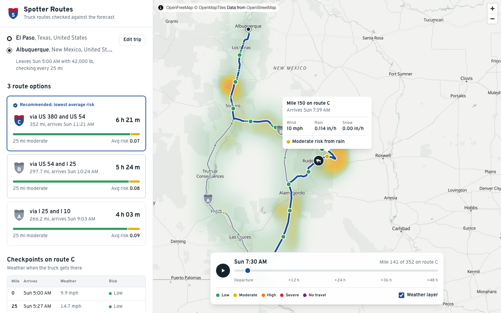

# Spotter Routes

Weather-aware truck routing. Enter an origin, a destination, a departure time and a load weight. The app finds three truck routes, checks the forecast for the hour the truck reaches each checkpoint, scores every route against the risk and load rules, and recommends the safest one. A heatmap with a 0–48 h slider shows the weather along the trip corridor.

**Live app:** https://spotter-routes.onrender.com

<picture>
  <source media="(prefers-color-scheme: dark)" srcset=".github/screenshot-dark.png">
  
</picture>

## Stack

| Layer    | Tools                                                                                     |
| -------- | ----------------------------------------------------------------------------------------- |
| Frontend | React 19, TypeScript, Vite, Tailwind CSS, MapLibre GL (`react-map-gl`), Vitest           |
| Backend  | Django 6, Django REST Framework, no database                                              |
| Data     | [Valhalla](https://valhalla.github.io/valhalla/) truck routing, [Open-Meteo](https://open-meteo.com) forecasts, [Photon](https://photon.komoot.io) place search, [OpenFreeMap](https://openfreemap.org) basemap |

## How it works

```
Browser                         Django  (backend/planner/)                Third-party APIs
───────                         ──────────────────────────                ────────────────
Place search ─ GET /api/places ─▶ clients/photon.py ─────────────────────▶ Photon
Trip form ──── POST /api/plan ──▶ services.plan_trip
                                   1. routes ──── clients/valhalla.py ───▶ Valhalla (truck)
                                   2. checkpoints and ETAs    (geo.py)
                                   3. weather ─── clients/open_meteo.py ─▶ Open-Meteo
                                   4. risk per checkpoint     (risk.py)
                                   5. ranking and reason      (risk.py)
Map, route cards, slider ◀──────── JSON: routes, checkpoints, heatmap
```

1. **Routes.** Valhalla's `truck` profile returns the fastest route and its alternatives. If it finds fewer than three, the client routes through a highway beside the trip's midpoint to get more, dropping any candidate that shares over 85 % of its path with a route already found.
2. **Checkpoints and ETAs.** Checkpoints sit at the origin, every 10, 25 or 50 miles, and at the destination. Valhalla's drive time for each maneuver is spread over that maneuver's geometry by distance, which gives the elapsed time at every point of the route. A checkpoint's ETA is the departure time plus the elapsed time at its mile.
3. **Weather.** A single batched Open-Meteo request covers every checkpoint and heatmap cell, from the departure hour through 48 h or the end of the trip, whichever is later. Each checkpoint uses the forecast hour its ETA falls in: wind speed at 10 m, plus rain, showers and snowfall over that hour.
4. **Risk.** Each checkpoint takes the worst level across wind, rain and snow:

   | Condition | Low         | Moderate  | High      | Severe    | No Travel |
   | --------- | ----------- | --------- | --------- | --------- | --------- |
   | Wind      | <25 mph     | 25–34     | 35–44     | 45–54     | ≥55 mph   |
   | Rain      | <0.10 in/hr | 0.10–0.25 | 0.25–0.50 | 0.50–1.00 | >1.00     |
   | Snow      | <0.5 in/hr  | 0.5–1.0   | 1.0–2.0   | 2.0–3.0   | >3.0      |

   Load rules: wind of 45–54 mph with a load over 30,000 lb is No Travel; 35–44 mph with a load over 40,000 lb is Severe.

5. **Recommendation.** Each checkpoint covers the road halfway to its neighbours, so route miles add up per risk level. Routes are ranked by fewest No Travel miles, then fewest Severe miles, then fewest High miles, then lowest distance-weighted average risk, then shortest travel time. The recommended card names the rule that decided it.
6. **Heatmap.** The corridor is a regular lat/lon grid around the routes, with cells of 0.1° to 0.5° depending on trip length. Each cell carries its risk level for every hour from 0 to 48, and the map draws them with MapLibre's GPU heatmap layer. The slider switches which hour the layer reads and moves a truck marker along the selected route.

## Run locally

Requires [uv](https://docs.astral.sh/uv/) (it installs Python 3.13) and Node 22.12+.

```bash
# Terminal 1: API on http://127.0.0.1:8000
cd backend
uv sync
uv run python manage.py runserver

# Terminal 2: app on http://localhost:5173 (proxies /api to Django)
cd frontend
npm install
npm run dev
```

## Tests and checks

```bash
cd backend
uv run python manage.py test planner
uv run ruff format --check . && uv run ruff check .

cd ../frontend
npm test
npm run lint && npm run format:check
```

GitHub Actions runs all of these on every push (`.github/workflows/ci.yml`).

## Deploy

The `Dockerfile` builds the React app and serves it from Django (WhiteNoise) alongside the API, on a single origin. `render.yaml` deploys it to [Render](https://render.com): **New → Blueprint**, then pick this repository.

| Variable               | Default                                  | Purpose                                            |
| ---------------------- | ---------------------------------------- | -------------------------------------------------- |
| `DJANGO_SECRET_KEY`    | generated by Render                      | Django secret key                                  |
| `DJANGO_ALLOWED_HOSTS` | `.onrender.com`                          | Comma-separated host names                         |
| `DJANGO_DEBUG`         | `true` locally, `false` in the image     | Debug mode; the secret key is required when off    |
| `VALHALLA_URL`         | `https://valhalla1.openstreetmap.de/route` | Routing server (e.g. a self-hosted Valhalla)     |
| `MAX_TRIP_MILES`       | `930`                                    | Longest straight-line trip the routing server accepts |
| `OPEN_METEO_API_KEY`   | empty                                    | Uses Open-Meteo's commercial API when set          |
| `MAX_WEATHER_POINTS`   | `550`                                    | Weather samples allowed per plan                   |
| `CLIENT_IP_HEADER`     | `HTTP_CF_CONNECTING_IP` on Render        | Header with the real client IP, for rate limits    |

`.github/workflows/keep-awake.yml` pings the app every 5 minutes so the free instance doesn't sleep. To enable it, set the repository variable `APP_URL` to the deployed URL.

## Project layout

```
backend/
  config/                 settings, URLs, WSGI
  planner/
    clients/              one module per third-party API, plus shared HTTP handling
    geo.py                polyline decoding, distances, interpolation, corridor grid
    risk.py               risk rules, route scoring, recommendation
    services.py           plan_trip: routes, checkpoints, weather, risk, heatmap
    serializers.py        request validation
    views.py              GET /api/places, POST /api/plan
    tests/                one test module per area
frontend/src/
  api.ts                  typed API client
  App.tsx                 layout and page state
  components/             TripForm, PlaceField, RouteList, CheckpointTable, TripMap, ForecastScrubber, Shield
  lib/                    map data, risk colors, formatting (with unit tests)
```
